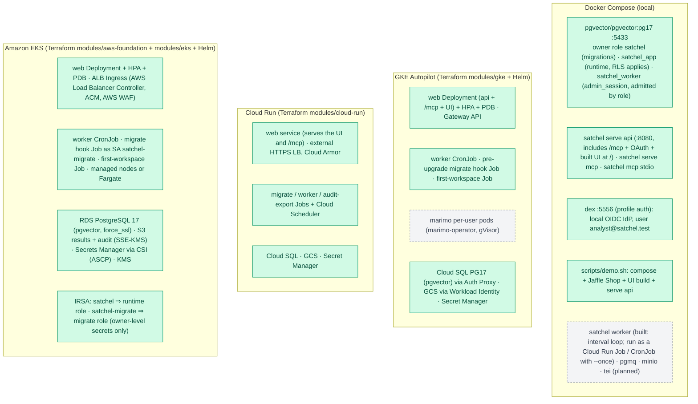

# Satchel — master architecture diagram

> **Living document.** Update this file in the same PR as any change that adds, removes or renames a component, table, tool or data flow, or that changes a component's status. Status colours: **built** (green) · **in progress** (amber) · **planned** (grey).
>
> Last updated: 2026-11-12.

## 1. System overview

```mermaid
flowchart LR
  classDef built fill:#d1fae5,stroke:#059669,color:#064e3b
  classDef wip fill:#fef3c7,stroke:#d97706,color:#78350f
  classDef planned fill:#f3f4f6,stroke:#9ca3af,color:#374151,stroke-dasharray:4 3
  classDef ext fill:#e0e7ff,stroke:#4f46e5,color:#1e1b4b

  subgraph Clients["Clients (bring your own agent)"]
    Claude["Claude Desktop / Code"]:::ext
    Cursor["Cursor / ChatGPT / Codex"]:::ext
    Marimo["marimo notebooks<br/>(satchel_ctx helper)"]:::planned
    CLI["satchel CLI<br/>onboarding: init · up/down/status · doctor · connect/disconnect (Claude Desktop/Code/Cursor) · upgrade<br/>config: ~/.config/satchel/config.toml profiles (env &gt; file &gt; defaults); bundled compose + Jaffle example; startup schema guard<br/>sources: source add|list|kinds|info|sync|remove · source validate (adapter inner loop, no database)"]:::built
    CI["GitHub Action (action/, getsatchel/satchel/action@vX.Y.Z)<br/>pull request: upload folder → preview → eval gate → PR comment, fails the check on a regression · push to default branch: import and publish"]:::built
    UI["Curator UI (ui/, built, served by satchel api at /)<br/>Inbox (suggestions + agent proposals) · Library · Changes/Workbench · Releases · Sessions · Observability · Jobs (queued, running, failed, done; attempts, errors; retry failed syncs, crawls and curation) · Catalog · Sources (sync, status, warnings; source badge, read-only source block and overlay editor on items) · Evals (suites with schedule and next run, run history with trigger, run detail, compare with the previous scheduled run; Run evals + gate in Changes) · Settings (Models: LLM connections, test, default; deployment values read-only · Connections: add, test, crawl, default, remove · Limits: row cap, timeout, result cache, session retention · Deployment: effective server config, read-only) · Sources add/edit/remove + upload and sync, files from a git repository (test, commit shown) · Sync automatically (every N hours) · Push webhook panel (set up / rotate / remove, secret shown once)"]:::built
  end

  subgraph Edge["Interfaces"]
    MCP["satchel mcp<br/>Streamable HTTP /mcp + stdio · bearer auth: PAT or OAuth access token (audience-checked)"]:::built
    API["satchel api (REST /v1, OpenAPI → ui/openapi.json)<br/>library · workbench (drafts, previews, publish, rollback) · proposals · suggestions (accept → draft, dismiss, complete) · POST /v1/curate/run (admin; queued curation.run job, 202, ?wait=true inline) · jobs (GET /v1/jobs, GET /v1/jobs/{id}, POST /v1/jobs/{id}/retry: curator, failed syncs/crawls/curation only) · observability · catalog · evals (/v1/evals/suites|runs|compare, /v1/previews/{id}/evals gate) · llm connections (/v1/llm-connections CRUD + test, admin; secrets write-only) · connections (/v1/connection-kinds, POST/PATCH/DELETE /v1/connections, /v1/connections/test, /v1/connections/{id}/crawl: queued job, 202, ?wait=true inline) · source writes (POST/PUT/DELETE /v1/sources) · sources (/v1/source-kinds, /v1/sources, POST /v1/sources/{id}/sync with optional artifact upload (inline) or without (queued job, 202, ?wait=true inline), PUT /v1/items/{key}/overlay) · context repo uploads (POST /v1/sync/preview curator: pull-request preview, versions not made current, release.ref set, not publishable from the UI · POST /v1/sync/import admin: import + publish, declared sources not synced; .tar.gz bundle, files and folders only, size capped) · source webhooks (POST/DELETE /v1/sources/{id}/webhook admin; unauthenticated receiver POST /v1/hooks/sources/{id}, GitHub X-Hub-Signature-256 / GitLab X-Gitlab-Token) · /v1/me<br/>roles admin &gt; curator &gt; analyst &gt; explorer · bearer or session cookie (+CSRF)<br/>dev header auth only with SATCHEL_DEV_AUTH=1"]:::built
    AS["satchel.oauth (mounted on api and mcp)<br/>OAuth 2.1 authorization server: /.well-known/*, /oauth/register|authorize|token|revoke<br/>OIDC login: /auth/login|callback|me|logout · PKCE S256 · DCR + CIMD · refresh rotation"]:::built
  end

  subgraph Core["satchel core (Python package)"]
    Registry["Tool registry (satchel.tools)<br/>10 context + signal tools + 5 data tools + app-only rate_result (data tools only with a connection)"]:::built
    Widget["Result widget (ui-widgets/ → satchel/resources/widgets/result.html)<br/>MCP Apps ui://satchel/result · text/html;profile=mcp-app · single inline file<br/>KPI tile or sortable table · filter chips · auto chart · pretty SQL/ctx chips · 👍 👎 + reasons · Load more rows"]:::built
    Items["core.item_types<br/>validate_item"]:::built
    Retrieval["retrieval<br/>hybrid search · RRF · priors · context packs"]:::built
    Signals["signals<br/>agent signals + implicit SQL extractors (sync, after run_sql)"]:::built
    Curation["curation<br/>release builder shared by import + publish · draft chunking/embedding · evidence redaction (M3a)<br/>M4: gap detector (greedy cosine clustering + thresholds) · hygiene (stale · dead · duplicate · contradiction) · golden-query candidates · suggestion drafting · apply (accept → draft)"]:::built
    Evals["evals (M5)<br/>suite YAML + limits · reference harness (tool-use loop, in-process invoke_tool pinned to a release, step cap) · graders: numeric_value, sql_equivalent, context_used (no LLM), judge_final_answer, judge_session · runner (4 cases at once, attempts, warn_only) · compare · publish gate (publish.require_evals) · schedule (suite schedule.interval_hours, run by the worker)"]:::built
    Sync["sync<br/>git import/export · wren/cube/ossie interop<br/>(git import built; sources: in satchel.config.yaml synced after files)"]:::wip
    Sources["sources (M7a)<br/>registry (entry-point group satchel.sources, built-ins + external) · apply.py: IR → asset_doc / semantic_model / golden_query / glossary_term, content-hash versions, field ownership (source block vs overlay), overlay_out_of_sync + endorsement_candidate signals, publish auto|preview + eval gate, held overlay drafts<br/>built-in adapters: dbt (manifest v10–v12, semantic_manifest → Wren MDL, catalog types, saved queries) · cube (M7b: YAML cubes/views → asset docs + one Wren MDL, optional /meta file or --meta-url, the only adapter that declares network) · sqlmesh (M7b: static MODEL/@model reader, audits → facts, lineage, no sqlmesh import)<br/>file inputs from a git repository (satchel.sources.git: https only, host pinned and checked, shallow sparse blob-filtered clone, no hooks/submodules/symlinks, commit recorded in the sync report), s3:// / gs://, uploads or (CLI) server paths<br/>dbt_build: dbt + git + dbt_project_dir → dbt deps + dbt parse (/opt/dbt/bin/dbt or SATCHEL_DBT_BIN; separate process, env from scratch, HOME/TMPDIR temp, in-memory DuckDB profile, timeout + setrlimit, project paths/packages checked; manifest + semantic_manifest fed to the dbt adapter, dbt version in the sync report)<br/>precedence (M7b): one primary asset_doc per table, sources[].priority lower wins, hand-written wins ties; sync report lists overlaps; overlapping semantic models served from the best only"]:::built
    SDK["satchel-adapter-sdk (sdk/, PyPI, pydantic + pyyaml only)<br/>IR + IR_VERSION · SourceAdapter protocol · AdapterInfo (requires = optional modules, listed unavailable with an install hint) · FileInput(multiple) folder inputs · MdlBuilder · testing kit (conformance, golden, --update-golden)"]:::built
    LLM["llm<br/>embeddings · chat (Anthropic, OpenAI-compatible incl. Ollama/vLLM/LiteLLM, fake) · connections: deployment SATCHEL_CHAT_* wins, else the workspace default llm_connection (core.crypto: AES-256-GCM, SATCHEL_ENCRYPTION_KEY, row-bound AAD, key rotation)"]:::built
  end

  subgraph Worker["satchel worker / satchel curate run"]
    Jobs["built: a pass every SATCHEL_CURATE_INTERVAL_MIN (or --once) queues a curation.run job per workspace: curate pipeline (embed signals → hygiene → golden candidates → gap clustering → drafting), advisory lock per workspace · after each pass: expired result purge, session retention (per-workspace limit) · scheduled source syncs on their own thread every SATCHEL_SOURCE_TICK_MIN (sync_interval_hours due, failures retried with backoff, advisory lock per source, unchanged git commit skipped) · scheduled evals: a third thread every SATCHEL_EVAL_TICK_MIN queues due suites (schedule.interval_hours, latest published release, advisory lock per suite, skipped without an LLM, previous scheduled run linked)<br/>job queue (satchel.jobs, table job): claim with FOR UPDATE SKIP LOCKED, lease renewed by a heartbeat (expired lease → claimed again), retries with backoff, dedupe key, give-up hook per kind; consumers: SATCHEL_WORKER_JOB_THREADS here (every kind), SATCHEL_WEB_JOB_THREADS in each web process (eval.run, source.sync, connection.crawl, curation.run); --once drains it; finished jobs purged after 14 days · result jsonb, GET /v1/jobs/{id} · kinds: eval.run (API, gate, schedule; retried once from scratch, then failed) · source.sync (Sync now without files, push webhooks, schedule; one queued + one running per source; busy → retry with backoff; a failed sync fails the job at once with its error; manual = forced, actor audited) · connection.crawl (Crawl; one per connection; connection errors fail at once) · curation.run (worker pass every SATCHEL_CURATE_INTERVAL_MIN per workspace, Run curation; one per workspace; a run holding the advisory lock → retry later; result = counts) · purges stay in the pass (global, idempotent) · Jobs page (status filter, retry)<br/>planned: schema crawl schedule"]:::wip
  end

  subgraph DataPlane["Data plane (optional)"]
    Conn["Connectors<br/>DuckDB · Postgres · BigQuery · Snowflake built<br/>crawl → asset rows + draft docs"]:::built
    Gateway["SQL gateway<br/>sqlglot read-only guardrails · row cap · timeout (per-workspace limits) · read-only session"]:::built
    Wren["wren-core-py (pinned)<br/>cube_query_to_sql → transform_sql → sqlglot dialect"]:::built
    Cache["Result cache<br/>Parquet in SATCHEL_RESULT_DIR (local dir, gs:// or s3://) + query_result table · ranged reads"]:::built
  end

  subgraph Storage["Storage"]
    PG[("Postgres 17 + pgvector<br/>RLS by workspace/user")]:::built
    OBJ[("Object store<br/>GCS (gs://) · Amazon S3 / S3-compatible (s3://)<br/>result cache · audit exports")]:::built
  end

  subgraph External["External systems"]
    WH[("Warehouses<br/>BigQuery · Snowflake · Postgres · Databricks · DuckDB")]:::ext
    Repo[("Context git repo<br/>md + YAML")]:::ext
    IdP["OIDC IdP<br/>Okta · Google · Entra · Dex"]:::ext
    Models["LLM / embedding APIs<br/>or local (fastembed / TEI / Ollama)"]:::ext
  end

  Claude & Cursor -->|MCP tools| MCP
  Marimo -->|REST| API
  CLI & UI -->|REST| API
  API -->|"drafts → preview release → publish / rollback; audit_event"| Curation
  Curation -->|"release + release_item; redacted evidence reads"| PG
  CI -->|preview · eval · publish| API
  MCP --> Registry
  MCP -->|"resources/read ui://satchel/result; structuredContent on run_sql / query_metrics / get_result (only if the client negotiated io.modelcontextprotocol/ui)"| Widget
  Claude -->|"host renders the widget in a sandboxed iframe"| Widget
  Widget -->|"postMessage → host → tools/call: rate_result (source=human), get_result"| MCP
  API --> Registry
  Registry --> Retrieval & Signals & Gateway
  API --> Sync & Curation & Evals & Sources
  CLI -->|"source validate (no database)"| SDK
  Sources -->|"load(config, files) → SourceSnapshot (pure, in-process)"| SDK
  Sources -->|"context_source · items managed_by=source · releases · hygiene signals"| PG
  LLM -->|"llm_connection (ciphertext only)"| PG
  Retrieval -->|"M7b: one served asset doc per table: primary by sources.priority, others folded in"| Sources
  Sync -->|"sources: list"| Sources
  GitHost["git hosts (GitHub, GitLab, Bitbucket, …)<br/>https, read-only token"]:::ext -->|"shallow sparse clone per sync"| Sources
  DbtHub["dbt package hub (hub.getdbt.com) and package git hosts"]:::ext -->|"dbt deps (optional, skippable)"| Sources
  Tools3["external adapter packages<br/>pip install satchel-source-foo"]:::ext -->|"entry point satchel.sources"| Sources
  Retrieval --> PG
  Signals --> PG
  Curation --> PG
  Curation -->|"draft prompts (redacted evidence)"| LLM
  Evals -->|"reference agent calls tools in-process (invoke_tool, release pinned, session tagged eval_run_id)"| Registry
  Evals -->|"agent loop + LLM judge"| LLM
  Evals -->|"eval_suite · eval_run · eval_case_result"| PG
  API -->|"job (eval.run, source.sync, connection.crawl, curation.run) queued; web consumers run it"| PG
  Sync <--> Repo
  Sync --> Items --> PG
  Jobs --> PG
  Jobs --> Curation & Evals & LLM
  Jobs -->|"scheduled sync (satchel.sources.automation)"| Sources
  GitHost -->|"push webhook POST /v1/hooks/sources/{id} (HMAC / token, branch filter) → background sync"| API
  LLM --> Models
  Gateway --> Conn
  Registry --> Wren --> Gateway
  Conn --> WH
  Conn -->|crawl| PG
  Gateway --> Cache --> PG
  Cache -->|"multi-replica: gs:// or s3://"| OBJ
  Registry -->|"rate_result: feedback(source=human, tool_call_id, client) + user_doubt(source=human) on 👎 (reasons in payload)"| Signals
  Signals -->|implicit: sql_error · retry_storm · undocumented · unendorsed · divergence| PG
  Claude -->|"401 → discovery → DCR/CIMD → authorize (browser) → token"| AS
  UI -->|"/auth/login → session cookie"| AS
  AS <-->|"OIDC code + PKCE; ID token validated; user mapped by sub, then email"| IdP
  AS --> PG
  MCP & API -->|"verify bearer / session"| PG
```



## 2. The curation loop

```mermaid
sequenceDiagram
  autonumber
  participant A as BYO agent (Claude)
  participant M as satchel mcp
  participant R as retrieval
  participant DB as Postgres
  participant W as worker
  participant C as Curator (UI)
  participant E as eval runner

  A->>M: start_analysis(question)
  M->>DB: session row
  A->>M: get_context_pack / search_context
  M->>R: build_context_pack(release=published)
  R->>DB: hybrid search + priors
  R-->>M: pack with [ctx:key@vN] tags
  M->>DB: served_context (item versions)
  A->>M: run_sql / query_metrics (question)
  M->>DB: tool_call + query_result + implicit signals (sql_error, retry_storm, undocumented_asset, unendorsed_used, metric_divergence)
  A->>M: report_answer / flag_context_gap / record_user_feedback
  M->>DB: signals + feedback
  W->>DB: nightly (satchel worker / curate run): embed signals → hygiene signals → cluster → suggestion rows (+ LLM-drafted changes, validated)
  C->>DB: review inbox: GET /v1/suggestions (+ /v1/proposals); accept / edit-and-accept (draft) / reject per change; dismiss with reason (fed back into prompts)
  C->>DB: POST /v1/previews (published + drafts), test via /v1/previews/{id}/search
  C->>E: run evals on preview release
  E->>M: reference agent sessions (in-process tools, release=preview, session.eval_run_id; excluded from observability, signals, curation)
  E-->>C: pass rate per measure vs the parent published release; publish refused (409) on regression unless an admin overrides
  C->>DB: POST /v1/previews/{id}/publish → new release (+ audit_event); rollback = re-publish an older mapping
  Note over A,DB: next sessions get the improved context
```

## 3. Data model (ER)

Relationships labelled "(planned)" are not in migrations yet.

```mermaid
erDiagram
  workspace ||--o{ app_user : has
  workspace ||--o{ domain : has
  workspace ||--o{ connection : has
  connection ||--o{ query_result : sourced_from
  session ||--o{ query_result : produced
  tool_call ||--o{ query_result : produced_by
  connection ||--o{ asset : catalogs
  asset ||--o{ asset : parent_of
  workspace ||--o{ context_item : owns
  context_item ||--o{ context_version : versions
  context_version ||--o{ context_chunk : chunks
  context_version ||--o{ context_entity_link : links
  asset ||--o{ context_entity_link : referenced_by
  workspace ||--o{ release : publishes
  release ||--o{ release_item : contains
  context_version ||--o{ release_item : pinned_in
  app_user ||--o{ api_token : holds
  workspace ||--o{ api_token : scopes
  oauth_client ||--o{ api_token : "issued to (oauth kinds)"
  oauth_client ||--o{ auth_flow : starts
  workspace ||--o{ auth_flow : "chosen during"
  app_user ||--o{ auth_flow : "mapped to"
  app_user ||--o{ web_session : "logs in as"
  workspace ||--o{ web_session : scopes
  app_user ||--o{ session : runs
  release ||--o{ session : served_from
  session ||--o{ tool_call : contains
  tool_call ||--o{ served_context : served
  context_version ||--o{ served_context : served_as
  session ||--o{ signal : emits
  session ||--o{ feedback : receives
  tool_call ||--o{ feedback : "rated (human via widget, or agent)"
  workspace ||--o{ audit_event : logs
  workspace ||--o{ suggestion : has
  suggestion ||--o{ suggestion_change : proposes
  suggestion ||--o{ suggestion_signal : evidence
  signal ||--o{ suggestion_signal : "in cluster"
  suggestion ||--o{ signal : "clustered_into"
  context_item ||--o{ suggestion_change : "target_item_id"
  asset ||--o{ suggestion_change : "target_asset_id"
  workspace ||--o{ context_source : has
  workspace ||--o{ llm_connection : configures
  connection ||--o{ context_source : "models live in"
  context_source ||--o{ context_item : "syncs (managed_by=source)"
  workspace ||--o{ eval_suite : has
  eval_suite ||--o{ eval_run : runs
  release ||--o{ eval_run : "evaluated (preview or published)"
  eval_run ||--o{ eval_case_result : grades
  eval_run ||--o{ session : "tags (session.eval_run_id)"
  workspace ||--o{ job : queues

  context_item {
    uuid id PK
    text type
    text key "stable path"
    text scope_kind
    text state
    text managed_by "ui | git | source"
    uuid source_id FK "nullable, migration 0009"
    text source_key "id in the upstream tool"
  }
  job {
    bigint id PK
    text kind "eval.run | source.sync | connection.crawl | curation.run"
    jsonb payload
    text dedupe_key "unique while queued or running"
    text status "queued | running | done | failed"
    int attempts
    int max_attempts
    timestamptz run_after "backoff"
    text locked_by
    timestamptz locked_until "lease"
    jsonb result "sync, crawl or curation report"
  }
  llm_connection {
    uuid id PK
    text name "unique per workspace"
    text provider "anthropic | openai_compat"
    text base_url
    text default_model
    text api_key_enc "enc:v1:<key id>:... AES-256-GCM"
    text api_key_hint "last four characters"
    text extra_headers_enc
    jsonb extra_header_names
    bool is_default "at most one per workspace"
  }
  context_source {
    uuid id PK
    text kind "dbt | cube | sqlmesh | ..."
    text name "unique per workspace"
    jsonb config "adapter config + publish + priority"
    uuid connection_id FK "warehouse the models live in"
    timestamptz last_synced_at
    text last_status "ok | error"
    text last_error
    text last_fingerprint "artifact hash"
    jsonb last_report "counts, warnings, release"
  }
  context_version {
    uuid id PK
    int seq
    text body
    jsonb provenance
    text content_hash
  }
  context_chunk {
    bigint id PK
    vector embedding "1024-d, HNSW"
    tsvector tsv "GIN"
    text embedding_model
  }
  api_token {
    uuid id PK
    text hash "sha256, unique"
    text kind "pat | oauth_access | oauth_refresh"
    text client_id FK "oauth rows"
    uuid family_id "one per grant; reuse revokes it"
    text resource "audience"
    text[] scopes
    timestamptz expires_at
    timestamptz revoked_at
    timestamptz rotated_at
    timestamptz last_used_at
  }
  oauth_client {
    uuid id PK
    text client_id "unique; lc_... (dcr) or https URL (cimd)"
    text client_name
    text[] redirect_uris
    text registration_kind "dcr | cimd"
    text token_endpoint_auth_method "none (public only)"
  }
  auth_flow {
    uuid id PK
    text kind "mcp | web"
    text status "idp, workspace, consent, code, redeemed, done, denied"
    text state_hash "IdP state"
    text code_hash "authorization code, single use, 60s"
    uuid family_id
    timestamptz expires_at
  }
  web_session {
    uuid id PK
    text hash "sha256 of cookie secret"
    text csrf
    timestamptz expires_at
    timestamptz revoked_at
  }
  session {
    uuid id PK
    text client
    text question
    bool sensitive "migration 0005: metadata only except to admins"
  }
  query_result {
    uuid id PK
    text sql
    int row_count
    bool truncated
    jsonb columns
    text path "parquet under SATCHEL_RESULT_DIR"
    timestamptz expires_at "7 days"
  }
  signal {
    bigint id PK
    text kind
    text source "agent | human | implicit | hygiene"
    vector embedding "filled by the curate job"
    uuid clustered_into FK "suggestion; migration 0006"
  }
  suggestion {
    uuid id PK
    text title
    text summary
    text status "open | completed | dismissed"
    text source "signals | hygiene | golden"
    text dismiss_reason
    int evidence_count
    int distinct_users
    int distinct_sessions
    timestamptz drafted_at "null = not drafted yet"
  }
  suggestion_change {
    uuid id PK
    text op "create_item | update_item | deprecate_item | endorse_asset | update_asset_doc | promote_golden_query"
    text item_type
    text proposed_key "new item"
    uuid target_item_id FK
    uuid target_asset_id FK
    text proposed_body "full body, not a patch"
    jsonb proposed_meta
    text status "pending | accepted | rejected | applied"
    jsonb result "item_key, seq or manual (git)"
  }
  suggestion_signal {
    uuid suggestion_id PK
    bigint signal_id PK
  }
```



## 4. Deployment


