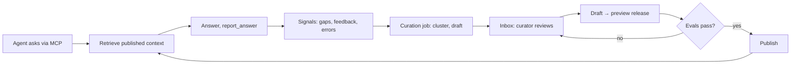

# How Satchel works

Satchel sits between your agents (Claude, Cursor, ChatGPT, Codex) and your data. People ask questions in their
agent, which connects over [MCP](../reference/mcp-tools.md); curators review and publish context in the web UI;
CI uses the REST API. What each person can do depends on their [role](#roles).

## The pieces

| Concept | What it is |
|---|---|
| **Workspace** | The tenancy boundary. Every row is scoped to one, enforced by Postgres row-level security. |
| **Member** | A person in a workspace, with one [role](#roles). Admins invite people by email under **Settings > Members**; the invite links to their account at your identity provider the first time they sign in. |
| **Context item** | A curated, versioned piece of knowledge: guide, glossary term, metric, golden query, table doc, endorsement, and the workspace's agent instructions (how agents should work and answer, on top of Satchel's own workflow). Context is shared and reviewed: every user of a workspace gets the same answers. Satchel keeps no per-user memory; a user's preferences belong to their own agent's memory, and a correction that matters to everyone becomes a signal. |
| **Release** | An immutable set of published context items. Agents read the published release. Changes go draft → preview release → publish, and can be rolled back. |
| **Source** | An upstream tool (dbt, Cube, SQLMesh, a git repo) synced into context. Fields are owned by the source or by a hand-written overlay. |
| **Connection** | A warehouse (Postgres, DuckDB today) used by the optional data plane to run governed, read-only SQL. |
| **Session** | One conversation with an agent: its tool calls, answers and feedback. A session holds one or more **questions** (turns), because agents often keep a session for follow-ups. Inspect them under **Sessions**; curators also get **Observability** (quality, adoption, grounding, performance and workflow adherence; see [Observability](observability.md)). |
| **Signal** | Something that says context was lacking: a flagged gap, a user correction, a SQL error, metric divergence. |
| **Suggestion** | A proposed change drafted from signals and hygiene checks. Reviewed in the **Inbox**. Two suggestions that propose exactly the same change are merged into the older one, which keeps the evidence of both. |
| **Eval suite** | Questions with graders, run against a release to gate publishing. |

<!-- site: ContextAnatomyDiagram -->

## The loop

<!-- site: CurationLoopDiagram -->

**Nothing auto-publishes.** Agents and the suggestion engine only propose changes. A human accepts a
suggestion into a draft, and a draft still goes through preview, [evals](evals.md) (if `publish.require_evals` is set)
and publish.

<!-- site: DocScreenshot defaultShot=changes-preview allowSwitch -->

## A typical agent session

1. `start_analysis` opens a session with the user's question and returns the workspace's agent instructions and rules.
2. `search_context` / `get_context_pack` retrieve definitions, then `describe_table` or `describe_metric`.
3. `query_metrics` (preferred) or `run_sql` fetches data through the guarded SQL gateway.
4. `report_answer` closes the session. `flag_context_gap` and `record_user_feedback` feed the loop.

### Questions within a session

Agents often keep one session for a whole conversation. Satchel groups a session's tool calls into **turns**, one per question: a new turn starts when a call carries a different question from the one being worked on. A follow-up after `report_answer` always starts one; before the answer, a reworded version of the same question stays in its turn. **Sessions** lists one row per question (switch to **Conversations** for one row per session), and a session with several questions shows them as a list to step through. Each signal records the turn it came from, so it is clustered with the question that was being asked, not the first one of the session. Curation works per question too:

- **Golden queries.** A question qualifies on its own calls: positive feedback and no negative feedback on that question, and a high-confidence `report_answer`. The candidate carries that question's text, so a 👎 on a later question does not hold back an earlier one.
- **Evidence.** In the Inbox, each piece of evidence is one question with its own text, linked to that question in the session inspector. The LLM drafting a fix sees only the calls of the questions its signals came from, plus the earlier questions' text for context.
- **Proposals** and **feedback** record the question being answered when the agent called `propose_context_change` or `record_user_feedback`.
- **Retention** counts a conversation's age from its latest question, so a long-running conversation is not deleted while it is still in use.

## Roles

Every member has one role. Each role can do everything the roles before it can.

- **Explorer.** Asks questions through an agent and reads the context. The default for people who sign in
  without an invite, when the workspace lets them in (**Settings > Members > Sign-in**).
- **Analyst.** Also sees the questions the rest of the team asked, and can have their agent propose a context change.
  The default role for an invite and for `satchel token create`.
- **Curator.** Looks after the context: reviews the Inbox, writes and edits items and the agent instructions,
  previews, runs evals, publishes and rolls back, and manages sources.
- **Admin.** Also manages the workspace: members, connections, models, limits, deployment settings and the audit
  log, and can override a failing eval gate.

| What | Explorer | Analyst | Curator | Admin |
|---|:-:|:-:|:-:|:-:|
| Ask questions through an agent: every MCP tool, including `run_sql` and `query_metrics` when the workspace has a connection | ✓ | ✓ | ✓ | ✓ |
| Read the context: Library, Catalog, published agent instructions | ✓ | ✓ | ✓ | ✓ |
| See their own questions and answers under **Sessions**, in full | ✓ | ✓ | ✓ | ✓ |
| See everyone's questions under **Sessions** (others' SQL values and long text redacted; sensitive sessions show metadata only) | | ✓ | ✓ | ✓ |
| Propose a context change from an agent (`propose_context_change`) | | ✓ | ✓ | ✓ |
| Start an eval run through the API (`POST /v1/evals/runs`) | | ✓ | ✓ | ✓ |
| Review the **Inbox**: accept or reject suggested changes and agent proposals | | | ✓ | ✓ |
| Write and edit context items and **Agent instructions** (as drafts) | | | ✓ | ✓ |
| Preview, run evals on, publish and roll back releases (**Releases**, **Evals**) | | | ✓ | ✓ |
| See **Observability** and **Settings > Jobs**; retry failed jobs | | | ✓ | ✓ |
| View sources, connections, models and limits; sync a source now; crawl a connection | | | ✓ | ✓ |
| Preview a context repo pull request (`POST /v1/sync/preview`, the GitHub Action) | | | ✓ | ✓ |
| Add, change or remove sources, connections and models; change limits | | | | ✓ |
| Invite members, change roles, deactivate people, set the sign-in policy (**Settings > Members**) | | | | ✓ |
| Publish over a failing eval gate (with a reason, audited) | | | | ✓ |
| Run curation now, import and publish a context repo (`POST /v1/sync/import`) | | | | ✓ |
| See raw evidence in every session, mark a session sensitive | | | | ✓ |
| **Settings > Deployment** and the audit log (`GET /v1/audit`) | | | | ✓ |

The server enforces every row of this table; the UI only hides what a role cannot use.

**In the web UI**, explorers and analysts get a short sidebar: **Home** (how to connect an agent, their recent
questions, and what the agent knows about), **Library**, **Catalog** and **Sessions**. Curators and admins get the
**Dashboard** and the full sidebar: Inbox, Library, Agent instructions, Releases, Sessions, Evals, Catalog,
Sources and Settings. Opening a page that is not for your role says so instead of showing an error.

**Changing roles.** Admins change roles and deactivate people under **Settings > Members**. You cannot change your
own role or deactivate yourself, and a workspace always keeps at least one active admin. A deactivated member's
tokens, sessions and sign-ins are refused until they are reactivated; their history stays. How people sign in
and how invites work: [Connecting Claude](../integrations/claude.md#remote-streamable-http-with-oauth-custom-connector).

## Architecture in one paragraph

One stateless server process (`satchel serve api`) serves the UI, REST, MCP at `/mcp`, and OAuth/OIDC. A
worker (`satchel worker`) queues curation, scheduled syncs and scheduled eval runs. Background work
(syncs, crawls, curation passes, eval runs) runs as jobs from a queue in Postgres, on the worker's and
the web servers' job threads; curators see it under **Settings > Jobs**. Postgres 17 with pgvector is the only
required dependency. An object store (GCS or S3) is optional for the result cache and audit exports. See the
[self-hosting overview](../self-hosting/index.md) and the [master diagram](../architecture/system.md).

<!-- site: SystemTopologyDiagram -->
