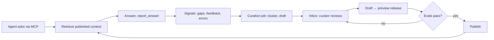

# How Satchel works

Satchel sits between your agents (Claude, Cursor, ChatGPT, Codex) and your data. Agents connect over
[MCP](../reference/mcp-tools.md); curators use the web UI; CI uses the REST API.

## The pieces

| Concept | What it is |
|---|---|
| **Workspace** | The tenancy boundary. Every row is scoped to one, enforced by Postgres row-level security. |
| **Context item** | A curated, versioned piece of knowledge: guide, glossary term, metric, golden query, table doc, endorsement. |
| **Release** | An immutable set of published context items. Agents read the published release. Changes go draft → preview release → publish, and can be rolled back. |
| **Source** | An upstream tool (dbt, Cube, SQLMesh, a git repo) synced into context. Fields are owned by the source or by a hand-written overlay. |
| **Connection** | A warehouse (Postgres, DuckDB today) used by the optional data plane to run governed, read-only SQL. |
| **Session** | One analysis: the question, every tool call, the answer and any feedback. Inspect them under **Sessions**. |
| **Signal** | Something that says context was lacking: a flagged gap, a user correction, a SQL error, metric divergence. |
| **Suggestion** | A proposed change drafted from signals and hygiene checks. Reviewed in the **Inbox**. |
| **Eval suite** | Questions with graders, run against a release to gate publishing. |

## The loop

**Nothing auto-publishes.** Agents and the suggestion engine only propose changes. A human accepts a
suggestion into a draft, and a draft still goes through preview, [evals](evals.md) (if `publish.require_evals` is set)
and publish.

## A typical agent session

1. `start_analysis` opens a session with the user's question.
2. `search_context` / `get_context_pack` retrieve definitions, then `describe_table` or `describe_metric`.
3. `query_metrics` (preferred) or `run_sql` fetches data through the guarded SQL gateway.
4. `report_answer` closes the session. `flag_context_gap` and `record_user_feedback` feed the loop.

## Architecture in one paragraph

One stateless server process (`satchel serve api`) serves the UI, REST, MCP at `/mcp`, and OAuth/OIDC. A
worker (`satchel worker`) runs curation on an interval. Postgres 17 with pgvector is the only required
dependency. An object store (GCS or S3) is optional for the result cache and audit exports. See the
[self-hosting overview](../self-hosting/index.md) and the [master diagram](../architecture/system.md).
