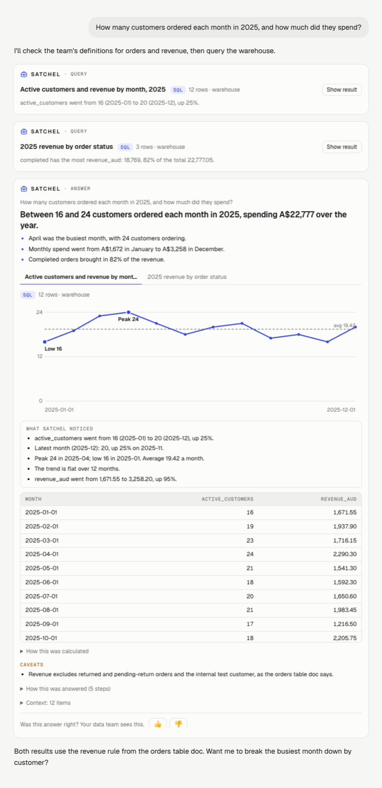

# MCP tools

Served at `/mcp` (streamable HTTP; PAT or OAuth) or over stdio (`satchel mcp stdio`). Tool visibility is per
principal and workspace; the data tools only appear when the workspace has a connection. Every member can use every
tool except `propose_context_change`, which needs the analyst role or above ([roles](../concepts/how-it-works.md#roles)).

Every call after `start_analysis` carries the `session_id` it returns, and the user's question. When an agent reuses a
session for a follow-up question, Satchel starts a new question (turn) inside it: after `report_answer`, any call with a
different question starts one. Signals, feedback and proposals record the question they belong to, so curation and the
Inbox treat each question on its own (see [How it works](../concepts/how-it-works.md#questions-within-a-session)).

The authoritative schemas are in `server/satchel/tools/definitions.py`; clients receive them via `tools/list`.

## Agent instructions

The server's `instructions` (sent at `initialize`) are Satchel's own workflow, the same for every workspace. A workspace adds
its own instructions on **Agent instructions** in the UI, or with `agent.md` at the root of the context repo: one
`agent_instructions` item, at most 8,000 characters, written by curators. Like any item it is a draft until it is previewed
and published, so eval runs against a preview use the new instructions before agents do, and a rollback restores the old
ones. Agents receive the published version from `start_analysis` (`agent_instructions`) and first in every context pack,
tagged `[ctx:agent.md@vN]`. Satchel's workflow tells agents that it wins where the two conflict. Agents cannot propose
agent instructions and the suggestion engine never drafts them.

## Session and answer

| Tool | Purpose |
|---|---|
| `start_analysis` | Begin a session for a data question. Call first, with the question verbatim. Returns the workspace's agent instructions (`agent_instructions`, if published) and always-on rules. |
| `report_answer` | Required final step: record the answer, metrics and tables used, confidence, caveats. Optional `headline`, `key_points` and `result_ids` shape the [answer card](#cards-in-claude-and-other-mcp-apps-hosts). |

## Context

| Tool | Purpose |
|---|---|
| `search_context` | Search metric definitions, glossary, table docs and guides. Call before writing SQL. |
| `get_context_pack` | Packed context for a question: agent instructions, rules, caveats, glossary, golden queries, table docs, guides. |
| `get_item` | Read one item in full by key (from a `[ctx:key@vN]` tag). |
| `list_tables` | List documented tables. |
| `describe_table` | Columns, enums, units, grain, caveats, endorsement. |

## Governed metrics and SQL (data plane)

| Tool | Purpose |
|---|---|
| `list_metrics` | Governed metrics, measures and dimensions. |
| `describe_metric` | One metric: expression, base filters, dimensions, grains. |
| `query_metrics` | Run a governed metric query. Preferred over raw SQL. |
| `run_sql` | One read-only `SELECT`/`WITH`, parsed with sqlglot, row-capped, timed out, read-only session. |
| `get_result` | Page through a previous result by `result_id`. |

## Feedback loop

| Tool | Purpose |
|---|---|
| `flag_context_gap` | A term or metric was undefined, ambiguous or conflicting. |
| `record_user_feedback` | The user doubted, corrected or praised an answer. Recorded against the question being answered. |
| `propose_context_change` | Analyst role and above. Propose a new or changed item. Never publishes; goes to the Inbox with the question it came from. Agent instructions cannot be proposed. |
| `rate_result` | App-only: the result widget's 👍/👎 (`source=human`). |

### Cards in Claude and other MCP Apps hosts

If the client negotiated `io.modelcontextprotocol/ui`, `run_sql`, `query_metrics`, `get_result` and
`report_answer` also return `structuredContent` that the `ui://satchel/result` widget shows as a Satchel card,
with Satchel's mark, colours and type so it looks like the web UI. Clients without the extension get the same
answer as text.

<!-- site: AnswerCardShot -->

- **Answer card** (`report_answer`). The question, the agent's `headline` (or `answer_summary`) and up to five
  `key_points`, then the question's results as tabs: the ones listed in `result_ids`, most important first, or
  by default the question's results that returned rows (up to four). Each tab has its chart, table, SQL and
  facts. Below: the caveats, the confidence when it is not high, **How this was answered** (every tool call of the
  question, empty and failed queries included; click one to open its tab), the context used and 👍/👎 for the
  shown result. The tool's text then tells the agent the user sees the card, so its reply adds only what the
  card does not say.
- **Query cards** (`run_sql`, `query_metrics`, `get_result`). One line each: the `title` (up to 120 characters,
  for example "Signups by month, 2025"; it defaults to the metric or the question), the row count and the first
  fact. **Show result** opens the chart, table, SQL, context and feedback. A result with no rows says "No rows
  matched this query" instead of an empty table. The text ends with a note telling the agent not to repeat the
  rows, because the user already sees them.

**Facts.** Satchel computes facts from a result's rows, never with a model: the change from the first to the
last period and on the previous one, the peak, low and average, the trend, an outlier, a last period that is not
over yet, the top value's share of the total, and columns that are mostly empty. `run_sql` and `query_metrics`
list them in their text so the agent can cite them, and the cards show them under **What Satchel noticed**,
with the average as a dashed line and the peak and low labelled on the chart. Facts quote values from the data,
so they are not stored with the tool call that other members may see in **Sessions**; the answer card computes
them again from the stored result.

The tool descriptions ask agents to title each query, put related figures in one query, check columns with
`describe_table` rather than with trial queries, and give the answer card a headline and key points drawn from
the facts.

<!-- site: McpToolsExplorer -->
